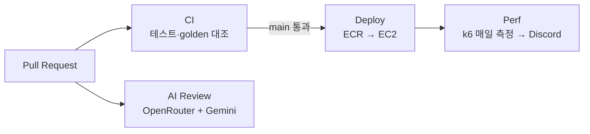
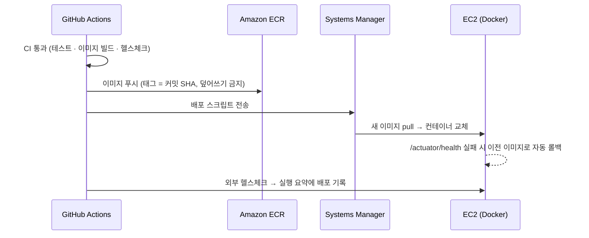

<div align="center">

# 💸 사회초년생 경제 시뮬레이터 — Backend

**"지금 이대로 모으면, 10년 뒤 목표를 이룰 수 있을까?"**<br>
2,000개의 미래를 몬테카를로로 돌려 확률로 답하는 API 서버


[](https://github.com/Financial-Simulation/capstone-backend/actions/workflows/ci.yml)

캡스톤디자인 6조

</div>

---

## 💭 무엇을 하나

| | |
|---|---|
| 🎲 **확률 시뮬레이션** | 소득·지출·대출·예정된 일을 받아 **2,000경로 × 120개월**을 계산하고 목표 달성 확률·범위·위험 원인을 돌려준다 |
| ⚖️ **계획 비교** | 지금 계획과 바꾼 계획(최대 4개)을 **같은 난수**로 계산해 공정하게 비교한다 |
| 🔁 **역산** | 목표를 이루려면 저축을 얼마로, 기간을 얼마나 늘려야 하는지 거꾸로 계산한다 |
| 🧾 **세금·혜택** | 연말정산·4대보험·청약·연금저축 반영, 청년 정책 혜택 판정과 자산 배분 추천 |
| 🛡️ **가정 흔들기** | 가정 60가지 × 2,000경로를 비동기 작업으로 돌려 결과가 얼마나 단단한지 본다 |

### 설계 원칙

- 🔒 **입력을 저장하지 않는다** — 입력은 브라우저에만 있고, 요청마다 본문으로 받는다
- 🎯 **같은 입력 + 같은 seed = 같은 결과** — 재현 가능, 응답에 항상 seed 반환
- 🧮 **계산은 백엔드 엔진 한 곳에서만** — 파이썬 기준 구현을 Java로 이식하고 정답(golden) 파일로 대조

## 🚀 빠른 시작

```bash
./gradlew bootRun          # http://localhost:8080
./gradlew test             # golden 대조 테스트 포함
```

Docker로 실행:

```bash
docker build -t capstone-backend .
docker run -p 8080:8080 capstone-backend
```

요청 예시는 [`http/demo.http`](http/demo.http)(발표 데모 순서)와 [`http/api.http`](http/api.http)에 있다.

### 환경변수

| 이름 | 기본값 | 설명 |
|---|---|---|
| `PORT` | `8080` | 서버 포트. JVM 메모리는 컨테이너 메모리의 75%까지 쓴다 |
| `APP_CORS_ALLOWEDORIGINS` | `application.properties`의 `app.cors.allowed-origins` | 프론트 주소 (쉼표로 여러 개) |

## 📡 API

모든 응답은 `{ isSuccess, code, message, result }` 형태로 감싼다.

| 메서드 | 경로 | 역할 |
|---|---|---|
| `POST` | `/api/inputs/validate` | 입력 단계별 검사 (저장 없음) |
| `POST` | `/api/loans/repayment-preview` | 대출 월 상환액 |
| `POST` | `/api/simulate` | 기본 결과: 확률·범위·위험·원인 |
| `POST` | `/api/simulate/story` | 최상·중간·최악 경로의 월별 이야기 |
| `POST` | `/api/simulate/preview` | 조절 막대: 지금 vs 바꾼 계획 |
| `POST` | `/api/compare` | 계획 최대 4개 비교 |
| `POST` | `/api/reverse` | 역산·비상금 전략·개선 포인트 |
| `POST` | `/api/benefits` | 청년 정책 혜택 판정 |
| `POST` | `/api/allocations/recommend` | 청년미래·청약·연금저축 배분 추천 |
| `POST` | `/api/reports` | 리포트 데이터 묶음 |
| `POST` | `/api/robust` | 가정 흔들기 작업 시작 (202) |
| `GET` | `/api/robust/{jobId}` | 작업 진행률·결과 |
| `GET` | `/api/meta` | 파라미터 + 근거·출처 |
| `GET` | `/api/events/presets` | 예정된 일 프리셋 |
| `GET` | `/api/examples` | 예시 사용자 입력 |
| `GET` | `/actuator/health` | 헬스체크 |

자세한 규칙과 계층 구조는 [`docs/architecture/api-overview.md`](docs/architecture/api-overview.md).

## 🗂️ 프로젝트 구조

```
src/main/java/.../capstoneserver
├── simulation/   시뮬레이션 API, 분석기, engine/(계산 엔진)
├── input/        입력 검증
├── loan/         대출 상환 계산
├── benefit/      청년 정책 혜택
├── report/       리포트
├── plan/         계획 조정(adjustments)
├── event/ example/
└── global/       공통 응답·예외·CORS
docs/             결정 기록·설계 문서 (→ docs/README.md)
http/             요청 예시
perf/k6/          부하·응답시간 측정
infra/ scripts/   AWS 권한, 배포·AI 리뷰 스크립트
```

## ⚙️ CI/CD



| 워크플로 | 하는 일 |
|---|---|
| [`ci.yml`](.github/workflows/ci.yml) | PR·main 푸시마다 테스트 |
| [`deploy.yml`](.github/workflows/deploy.yml) | main CI 통과 시 이미지(태그 = 커밋 SHA)를 ECR에 올리고 EC2에 배포. 수동 실행으로 롤백 |
| [`perf.yml`](.github/workflows/perf.yml) | 매일 09:00(KST) 배포 서버 응답 시간 측정 → 디스코드 |
| [`ai-review.yml`](.github/workflows/ai-review.yml) | PR 변경분을 여러 모델이 병렬 리뷰 (참고용, CI를 막지 않음) |

<details>
<summary><b>🤖 AI 리뷰 설정</b></summary>

<br>

PR 변경분을 OpenRouter의 최대 4개 모델과 Google Gemini API에 동시에 보낸다. 결과는 소요 시간과 함께
모델별 접기 섹션이 있는 댓글 하나로 게시하며, 실패한 모델이 있어도 성공한 결과는 남는다.

1. **Settings → Secrets and variables → Actions**에서 `OPENROUTER_API_KEY`, `GEMINI_API_KEY` 시크릿 등록
2. 같은 위치의 Variables에 `AI_REVIEW_MODELS` 등록 (JSON 배열 또는 쉼표 구분)<br>
   예: `["openai/gpt-4.1-mini","anthropic/claude-3.7-sonnet"]`
3. 등록하지 않으면 `AI_REVIEW_MODEL` 값 또는 `nvidia/nemotron-3.5-lightning:free` 한 모델만 사용
4. `GEMINI_MODEL`로 직접 호출할 Gemini 모델을 선택할 수 있다 (기본값 `gemini-3.6-flash`)

> [!WARNING]
> 모델 종류와 호출 횟수에 따라 비용이 생길 수 있다. 모델별 데이터 처리 정책을 확인하고,
> 외부로 보내면 안 되는 코드가 있는 저장소에는 쓰지 않는다. 포크 PR은 시크릿을 못 읽어 실행되지 않는다.

</details>

## ☁️ 배포 — AWS

**main에 머지하면 자동으로 EC2에 배포된다.**



| 구성 | 내용 |
|---|---|
| 서버 | EC2 `t3.small` (Amazon Linux 2023), 탄력적 IP, 80 → 8080 |
| 이미지 | ECR 비공개 저장소, 태그 변경 불가 + 푸시 시 스캔 |
| 접속 | SSH 포트 닫음. 명령은 **SSM**으로만 보낸다 |
| 권한 | 배포 전용 IAM 사용자, 권한은 [`infra/aws/`](infra/aws) 정책 범위로 제한 |
| 롤백 | 헬스체크 실패 시 자동. 수동 실행(`workflow_dispatch`)으로 예전 커밋 재배포 |
| 모니터링 | k6로 매일 응답 시간 측정 → 디스코드 |

- 배포 스크립트: [`scripts/deploy/ec2-deploy.sh`](scripts/deploy/ec2-deploy.sh)
- 처음 설정 순서: [`setup-aws.md`](docs/tasks/infra-queue-k6-aws-cicd/setup-aws.md)

<details>
<summary><b>🎨 Render 배포 (대안)</b></summary>

<br>

1. New → Web Service → 이 저장소 연결, Language는 **Docker**
2. 브라우저가 이 서버를 바로 부르면 `APP_CORS_ALLOWEDORIGINS`에 프론트 주소를 넣는다. 프론트 서버가 대신 부르면(Next rewrites) 필요 없다
3. 무료 플랜(CPU 0.1개, 512MB)에서는 `/allocations/recommend`·`/robust`가 많이 느리다. 계산까지 시연하려면 유료 플랜을 쓴다

</details>

## 🗺️ 문서

- [`docs/README.md`](docs/README.md) — 작업별 결정 기록(decision · context · checklist)
- [`docs/architecture/api-overview.md`](docs/architecture/api-overview.md) — API 한눈에 보기
- AWS 설정 순서 — [`docs/tasks/infra-queue-k6-aws-cicd/setup-aws.md`](docs/tasks/infra-queue-k6-aws-cicd/setup-aws.md)
